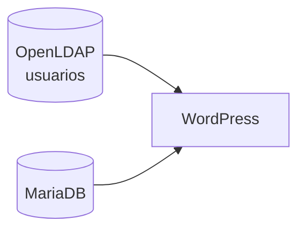
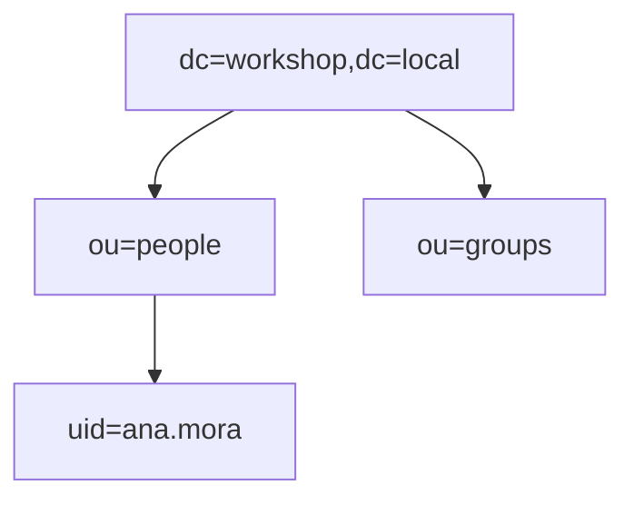
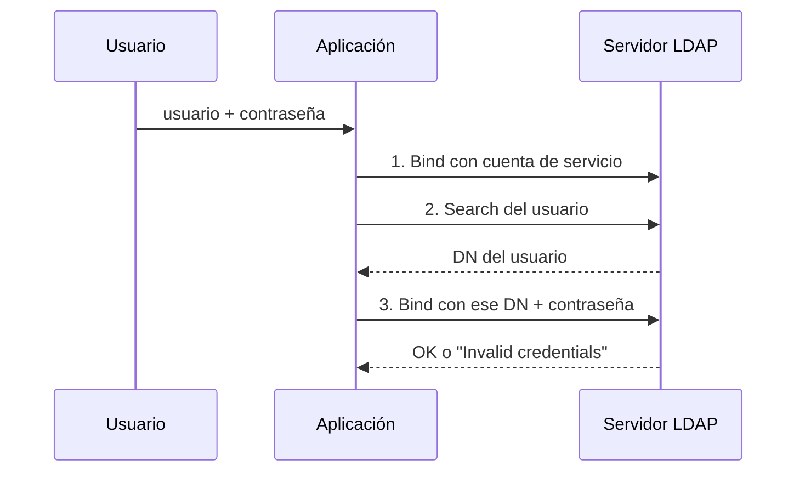
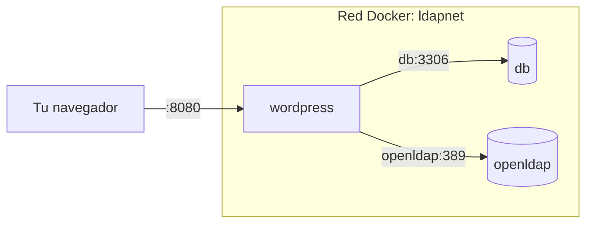
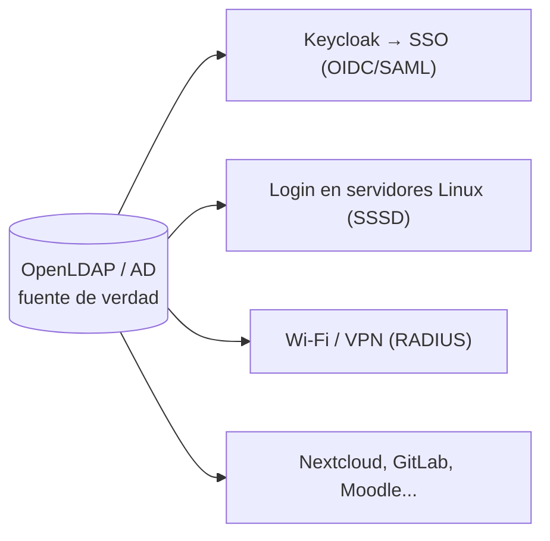

# Workshop: Docker + LDAP, construyendo paso a paso

Guía práctica para seguir en vivo. En cada bloque lees una idea corta, ejecutas los comandos y confirmas que funcionó antes de avanzar. Para la teoría completa y el paso a paso detallado consulta [README_FULL.md](README_FULL.md).

**Duración:** ~2 h 15 min, con una pausa.

**Meta:** al final, un usuario que crees en LDAP aparecerá en WordPress sin que toques WordPress.



---

## Cómo usar esta guía

Cada bloque tiene tres partes:

```
💡 Concepto (lee)  →  🛠 Hacer (copia y ejecuta)  →  ✅ Checkpoint (verifica)
```

- Copia los comandos tal como aparecen y ejecútalos en tu terminal, **desde la carpeta del proyecto**.
- En el **checkpoint**, escribe `ok` en el chat si el resultado coincide con lo esperado. Si no, escribe `error` y pega la **última línea** del mensaje de error.
- No avances al siguiente bloque hasta tener tu checkpoint en `ok`. Cada bloque depende del anterior.

---

## Antes de empezar (haz esto antes de la sesión)

### 1. Verifica Docker

```bash
docker --version
docker compose version
docker run hello-world
```

Debes ver `Hello from Docker!`. Si no tienes instalado no funcionará.

### 2. Descarga las imágenes

Así evitas esperar durante la sesión:

```bash
docker pull nginx
docker pull osixia/openldap:1.5.0
docker pull mariadb:11
docker pull wordpress:php8.3-apache
docker pull osixia/phpldapadmin:0.9.0
```

### 3. Clona el repositorio y entra a la carpeta

```bash
git clone <URL-DEL-REPOSITORIO> ldap_auth_workshop
cd ldap_auth_workshop
```

### 4. Solo si usas Mac con Apple Silicon (M1/M2/M3/M4)

En `docker-compose.yml`, agrega esta línea dentro de los servicios `openldap` y `phpldapadmin`:

```yaml
    platform: linux/amd64
```

---

## Agenda

| Hora | Bloque |
|---|---|
| 0:00 | **1. Tu primer contenedor** |
| 0:15 | **2. Levantar OpenLDAP** |
| 0:40 | **3. Consultar el directorio** |
| 1:00 | ☕ Pausa (10 min) |
| 1:10 | **4. Construir tu propia imagen** |
| 1:25 | **5. WordPress + MariaDB** |
| 1:40 | **6. Conectar WordPress a LDAP** |
| 2:00 | **7. El momento wow y cierre** |

---

## Bloque 1 — Tu primer contenedor (15 min)

### 💡 Concepto: imagen vs. contenedor

- **Imagen:** plantilla inmutable (como una clase).
- **Contenedor:** instancia en ejecución de una imagen (como un objeto). Es un **proceso aislado** de tu máquina, no una máquina virtual.

### 🛠 Hacer

Inicia un servidor web nginx en segundo plano:

```bash
docker run -d --name prueba -p 8000:80 nginx
```

Verifica que está corriendo y mira su proceso:

```bash
docker ps
docker top prueba
```

Abre en tu navegador: <http://localhost:8000>

Elimina el contenedor:

```bash
docker rm -f prueba
```

Recarga <http://localhost:8000>: ya no responde.

### ✅ Checkpoint

Viste la página "Welcome to nginx!" mientras el contenedor existía.

> Al borrar el contenedor, todo lo que contenía desapareció. Los contenedores son **efímeros**; más adelante veremos cómo conservar datos con **volúmenes**.

---

## Bloque 2 — Levantar OpenLDAP (25 min)

### 💡 Concepto A: Docker Compose

Un archivo (`docker-compose.yml`) describe **todos** los servicios, redes y volúmenes de tu aplicación. Un solo comando los levanta. Hoy empezamos solo con el servicio `openldap`.

### 💡 Concepto B: ¿qué es LDAP?

Una **libreta de direcciones jerárquica**, optimizada para lectura, donde viven usuarios y grupos. Su valor: **una sola fuente de verdad para las identidades** de toda una organización.

Para una empresa que tiene un dominio "workshop.local", este es el árbol LDAP que vamos a crear:



### 🛠 Hacer

**1. Crea tu archivo de variables** a partir del ejemplo:

```bash
cp .env.example .env
```

Ábrelo y observa `LDAP_DOMAIN=workshop.local`: Docker lo convierte en la raíz del árbol, `dc=workshop,dc=local`.

**2. Revisa los datos iniciales.** Abre `ldif/01-usuarios.ldif` y mira la entrada de Ana:

```ldif
dn: uid=ana.mora,ou=people,dc=workshop,dc=local
objectClass: inetOrgPerson
uid: ana.mora
cn: Ana Mora
...
```

- `dn` (Distinguished Name): la dirección única de la entrada. Se lee de derecha a izquierda.
- `objectClass`: el tipo de entrada; define qué atributos tiene.
- Las **líneas en blanco separan** entradas.

**3. Levanta solo OpenLDAP:**

```bash
docker compose up -d openldap
```

Observa los logs (sal con `Ctrl+C`):

```bash
docker compose logs -f openldap
```

### 💡 Concepto C: volúmenes

En `docker-compose.yml`, el servicio `openldap` monta `ldap_data` y `ldap_config`. Son **volúmenes**: guardan los datos fuera del contenedor para que sobrevivan si este se borra.

### ✅ Checkpoint

```bash
docker compose ps
```

`openldap` debe aparecer con estado `running`.

---

## Bloque 3 — Consultar el directorio (20 min)

### 💡 Concepto: bind, search y filtros

Solo tres ideas hoy:

- **Bind:** autenticarse ante LDAP (con un usuario y contraseña).
- **Search:** buscar entradas.
- **Filtro:** la condición de la búsqueda.

| Filtro | Significa |
|---|---|
| `(uid=ana.mora)` | uid igual a `ana.mora` |
| `(objectClass=inetOrgPerson)` | todas las personas |
| `(&(objectClass=inetOrgPerson)(title=Docente))` | personas **Y** con título Docente |

### 🛠 Hacer

**1. Lista todos los usuarios:**

```bash
docker exec openldap ldapsearch -x -H ldap://localhost \
  -b "ou=people,dc=workshop,dc=local" \
  -D "cn=admin,dc=workshop,dc=local" -w admin123 \
  "(objectClass=inetOrgPerson)" uid cn mail title departmentNumber
```

**2. Busca solo a los docentes** (cambia el filtro):

```bash
docker exec openldap ldapsearch -x -H ldap://localhost \
  -b "ou=people,dc=workshop,dc=local" \
  -D "cn=admin,dc=workshop,dc=local" -w admin123 \
  "(&(objectClass=inetOrgPerson)(title=Docente))" uid cn
```

**3. Comprueba que Ana puede autenticarse con su propia contraseña:**

```bash
docker exec openldap ldapwhoami -x -H ldap://localhost \
  -D "uid=ana.mora,ou=people,dc=workshop,dc=local" -w Ana12345
```

### 💡 Concepto: cómo autentica una aplicación

Así es como WordPress (y casi cualquier app) valida un login contra LDAP: patrón **search + bind**.



La aplicación **nunca guarda la contraseña**: se la pregunta a LDAP.

### ✅ Checkpoint

El comando 3 debe imprimir:

```
dn:uid=ana.mora,ou=people,dc=workshop,dc=local
```

### 🎯 Mini-reto

Escribe un filtro y un comando `ldapsearch` que devuelva **solo a Luis Vargas**. Comparte tu filtro en el chat.

---

## ☕ Pausa (10 min)

---

## Bloque 4 — Construir tu propia imagen (15 min)

### 💡 Concepto: Dockerfile

Un **Dockerfile** es la receta para construir una imagen. Las imágenes se arman por **capas**: cada instrucción agrega una.

Problema real: la imagen oficial de WordPress **no incluye la extensión PHP `ldap`**, y sin ella ningún plugin LDAP funciona. La solución es extender la imagen oficial con una capa propia.

### 🛠 Hacer

**1. Lee `wordpress/Dockerfile`:**

```dockerfile
FROM wordpress:php8.3-apache

RUN apt-get update \
 && apt-get install -y --no-install-recommends libldap2-dev \
 && docker-php-ext-configure ldap --with-libdir=lib/$(uname -m)-linux-gnu/ \
 && docker-php-ext-install ldap \
 && rm -rf /var/lib/apt/lists/*
```

- `FROM`: imagen base que extendemos.
- `apt-get install libldap2-dev`: librería del sistema necesaria.
- `docker-php-ext-install ldap`: compila la extensión de PHP.
- `$(uname -m)`: hace que funcione igual en Intel/AMD y en ARM.

**2. Construye la imagen** (tarda 1–3 minutos):

```bash
docker compose build wordpress
```

### ✅ Checkpoint

El build termina sin errores y la última línea indica que la imagen fue creada.

---

## Bloque 5 — WordPress + MariaDB (15 min)

### 💡 Concepto: red y DNS interno

Compose crea una **red** privada y los contenedores se encuentran **por el nombre del servicio**. WordPress llegará a `db` y a `openldap` sin conocer sus IPs.



Pregunta para pensar: ¿por qué el servicio `db` **no** publica el puerto 3306 a tu máquina? (Respuesta: mínima exposición; solo WordPress necesita hablar con ella.)

### 🛠 Hacer

**1. Levanta todos los servicios:**

```bash
docker compose up -d
docker compose ps
```

**2. Comprueba que WordPress tiene la extensión LDAP:**

```bash
docker exec wordpress php -m | grep -i ldap
```

Debe imprimir `ldap`.

**3. Comprueba que WordPress alcanza a OpenLDAP por nombre:**

```bash
docker exec wordpress php -r '
$c = ldap_connect("ldap://openldap:389");
ldap_set_option($c, LDAP_OPT_PROTOCOL_VERSION, 3);
var_dump(ldap_bind($c, "cn=admin,dc=workshop,dc=local", "admin123"));'
```

**4. Instala WordPress:** abre <http://localhost:8080> y completa el asistente (idioma, título del sitio, usuario administrador local).

> Si ves "Error establishing a database connection", espera 20 segundos y recarga: MariaDB aún está iniciando.

### ✅ Checkpoint

- El paso 3 imprime `bool(true)`.
- WordPress está instalado y entras a `/wp-admin`.

> Si llegaste aquí, cualquier fallo posterior será de **configuración del plugin**, no de Docker ni de red.

---

## Bloque 6 — Conectar WordPress a LDAP (20 min)

### 💡 Concepto: valores de conexión

El plugin necesita saber **dónde** está LDAP y **cómo** buscar. El error más común: poner `localhost` como host. Dentro del contenedor de WordPress, `localhost` es WordPress mismo, no OpenLDAP. El host correcto es el nombre del servicio: **`openldap`**.

### 🛠 Hacer

1. En `/wp-admin`, ve a **Plugins → Añadir nuevo**, busca el plugin LDAP indicado en la sesión, **Instalar** y **Activar**.
2. Configura la conexión con estos valores (los nombres de los campos varían un poco según el plugin):

| Campo | Valor |
|---|---|
| Servidor / Host | `openldap` |
| Puerto | `389` |
| Usar TLS/SSL | No |
| Versión del protocolo | 3 |
| Bind DN | `cn=admin,dc=workshop,dc=local` |
| Contraseña del Bind | `admin123` |
| Base DN | `ou=people,dc=workshop,dc=local` |
| Filtro | `(objectClass=inetOrgPerson)` |
| Atributo de usuario | `uid` |
| Full name (nombre completo) | `cn` |
| Email | `mail` |
| Job title (cargo) | `title` |
| Department (departamento) | `departmentNumber` |
| Phone (teléfono) | `telephoneNumber` |

3. Guarda y visualiza el directorio en tu sitio.

### ✅ Checkpoint

Ves a **Ana, Luis y Sofía** en WordPress.

> **Si algo falla:** revisa la tabla de errores al final de esta guía. Si el plugin no cooperara, continúa con el Bloque 7: puedes verificar el resultado con el comando `ldapsearch` del Bloque 3.

---

## Bloque 7 — El momento wow y cierre (20 min)

### 🛠 Hacer: crea un usuario solo en LDAP

Crea el archivo y cárgalo en el directorio:

```bash
cat > nuevo.ldif <<'EOF'
dn: uid=pedro.solis,ou=people,dc=workshop,dc=local
objectClass: inetOrgPerson
uid: pedro.solis
cn: Pedro Solis
sn: Solis
mail: pedro.solis@workshop.local
title: Estudiante
departmentNumber: Administracion
userPassword: Pedro12345
EOF

docker cp nuevo.ldif openldap:/tmp/nuevo.ldif
docker exec openldap ldapadd -x -H ldap://localhost \
  -D "cn=admin,dc=workshop,dc=local" -w admin123 -f /tmp/nuevo.ldif
```

Recarga la página de WordPress: **Pedro aparece sin que hayas tocado WordPress.**

### ✅ Checkpoint

Pedro aparece en tu sitio.

> **La idea del taller:** una sola fuente de verdad para las identidades.

### 💡 Para qué más se usa LDAP



Cuando alguien deja la organización, se desactiva **una** cuenta y pierde acceso a todo. Sin un directorio central quedan cuentas huérfanas en cada sistema.

### ⚠️ Esto es un laboratorio, no producción

Para simplificar usamos: sin TLS, contraseñas en texto plano, `cn=admin` como cuenta de la aplicación. En producción se usa:

- LDAPS (puerto 636)
- una cuenta de servicio de **solo lectura**
- contraseñas con hash (`slappasswd`)
- secretos fuera del repositorio

### Limpieza

Detiene y borra los contenedores (conserva los datos):

```bash
docker compose down
```

Reinicio total (borra también los volúmenes):

```bash
docker compose down -v
```

### 🏠 Tarea opcional

1. Agrega un usuario con `title: Coordinador` y un grupo `coordinacion`.
2. Cambia el teléfono de un usuario con `ldapmodify` y verifica el cambio en WordPress.
3. Crea una cuenta de solo lectura `cn=wp-reader,dc=workshop,dc=local` y úsala en el plugin en lugar de `cn=admin`. ¿Por qué es más seguro?

---

## Solución de problemas

| Síntoma | Causa probable | Solución |
|---|---|---|
| `Can't contact LDAP server (-1)` | Host `localhost` o contenedor caído | Usa `openldap` como host; revisa `docker compose ps` |
| `Invalid credentials (49)` | DN o contraseña erróneos | Revisa el DN completo y tu `.env` |
| `No such object (32)` | Base DN incorrecto | Prueba con `-b "dc=workshop,dc=local"` para ver todo el árbol |
| El plugin dice "LDAP extension not loaded" | Se usó la imagen oficial sin construir la propia | `docker compose up -d --build` y `docker exec wordpress php -m \| grep ldap` |
| No aparecen los usuarios iniciales | El volumen ya existía de un intento anterior, o error de sintaxis en el LDIF | `docker compose down -v`, vuelve a levantar y revisa `docker compose logs openldap` |
| "Error establishing a database connection" | MariaDB aún iniciando | Espera 20 s y recarga |
| Puerto 389, 8080 u 8081 ocupado | Otro programa lo usa | Cambia el mapeo en `docker-compose.yml`, p. ej. `"1389:389"` |
| `exec format error` en Mac M1+ | Imagen solo amd64 | Agrega `platform: linux/amd64` al servicio |

**Comandos de diagnóstico:**

```bash
docker compose ps
docker compose logs openldap --tail 50
docker exec -it wordpress bash
```
