# Workshop: Contenedores con Docker + Directorios con LDAP

**Demostración:** WordPress en Docker autenticando/consultando usuarios de un servidor OpenLDAP en Docker.
**Requerimientos:** conocimientos básicos de Linux (terminal, rutas, permisos, editar archivos).
**Duración aproximada:** 2 horas (60 min teoría + 60 min laboratorio).

> **¿Buscas la guía para seguir durante la sesión?** Usa la [guía práctica (README.md)](README.md): conceptos cortos intercalados con los comandos. Este documento es la **referencia completa** con la teoría y el paso a paso detallado.

---

## Índice

1. [Objetivos](#1-objetivos)
2. [Conceptos de Docker](#2-conceptos-de-docker)
3. [Conceptos de LDAP](#3-conceptos-de-ldap)
4. [Arquitectura del laboratorio](#4-arquitectura-del-laboratorio)
5. [Laboratorio paso a paso](#5-laboratorio-paso-a-paso)
6. [Flujo de conexión entre contenedores](#6-flujo-de-conexión-entre-contenedores)
7. [Otros casos de uso de LDAP](#7-otros-casos-de-uso-de-ldap)
8. [Solución de problemas](#8-solución-de-problemas)
9. [Notas para el instructor](#9-notas-para-el-instructor)
10. [Ejercicios de cierre](#10-ejercicios-de-cierre)

> Los diagramas están en **Mermaid**. Se renderizan en GitHub, GitLab, Obsidian, VS Code (extensión *Markdown Preview Mermaid Support*) y Typora.

---

## 1. Objetivos

Al terminar, podremos:

- Comprender la diferencia entre **imagen**, **contenedor**, **volumen** y **red** en Docker.
- Levantar un entorno multi-contenedor con **Docker Compose**.
- Construir una imagen propia con un **Dockerfile**.
- Describir la estructura jerárquica de un directorio **LDAP** (DIT, DN, atributos, objectClass).
- Cargar usuarios en OpenLDAP con un archivo **LDIF** y consultarlos con `ldapsearch`.
- Conectar una aplicación real (WordPress) para extraer datos usando LDAP.

---

## 2. Conceptos de Docker

### 2.1 ¿Qué problema resuelve?

"En mi máquina sí funciona." Docker empaqueta la aplicación **con** sus dependencias (librerías, runtime, configuración) en una unidad portable que corre igual en cualquier host con Docker.

### 2.2 Máquina virtual vs. contenedor

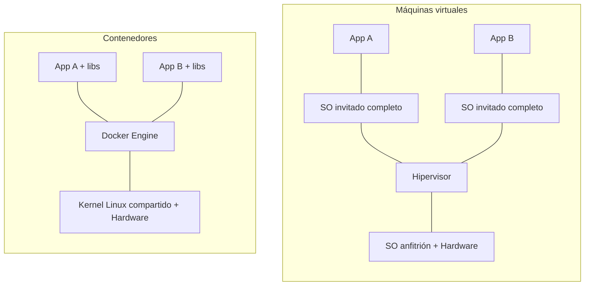

Comparativa:  

| Aspecto | Máquina virtual | Contenedor |
|---|---|---|
| Aislamiento | Kernel propio (fuerte) | Comparte kernel del host (namespaces + cgroups) |
| Arranque | Minutos | Segundos |
| Tamaño | GB | MB |
| Uso típico | SO distintos, aislamiento duro | Microservicios, entornos reproducibles |

> **Idea clave:** un contenedor **no es una VM liviana**; es un **proceso aislado** del host. `docker top <contenedor>` lo demuestra.

### 2.3 Vocabulario esencial

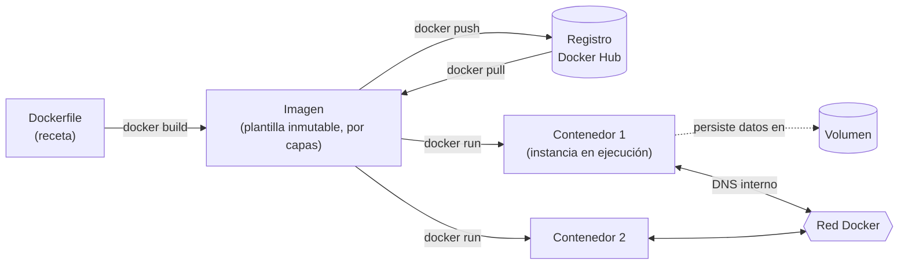

| Concepto | Analogía | Comando clave |
|---|---|---|
| **Imagen** | Clase / molde | `docker images`, `docker pull` |
| **Contenedor** | Objeto / instancia | `docker ps`, `docker run`, `docker exec` |
| **Dockerfile** | Receta | `docker build` |
| **Volumen** | Disco externo | `docker volume ls` |
| **Red** | Switch virtual con DNS | `docker network ls` |
| **Compose** | Partitura que orquesta varios contenedores | `docker compose up -d` |

### 2.4 Imágenes por capas

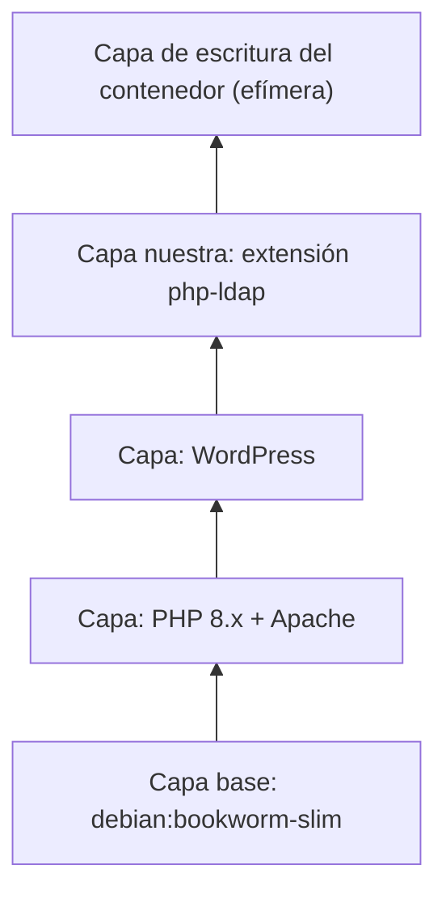

Todo lo escrito en la capa del contenedor **se pierde al borrarlo**. Por eso los datos van a **volúmenes**.

### 2.5 Ciclo de vida de un contenedor

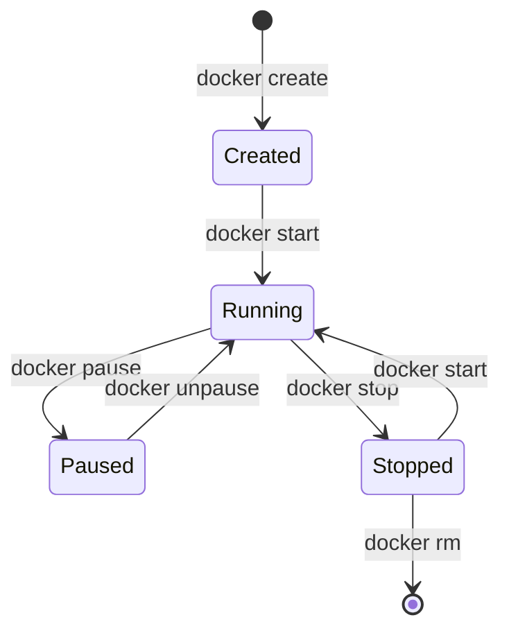

### 2.6 Redes: por qué los contenedores se encuentran por nombre

En una red definida por el usuario (la que crea Compose), Docker ofrece **DNS interno**: el contenedor `wordpress` llega al servidor LDAP usando el nombre del servicio `openldap`, sin conocer su IP.

---

## 3. Conceptos de LDAP

### 3.1 ¿Qué es?

**LDAP (Lightweight Directory Access Protocol)** es un protocolo estándar (RFC 4511) para consultar y modificar un **directorio**: una base de datos jerárquica, optimizada para **muchas lecturas y pocas escrituras**, donde típicamente se guardan usuarios, grupos, equipos y permisos.

| | Base de datos relacional | Directorio LDAP |
|---|---|---|
| Estructura | Tablas | Árbol jerárquico |
| Optimización | Lectura/escritura balanceada | Lectura intensiva |
| Consulta | SQL | Filtros LDAP `(&(objectClass=person)(uid=ana))` |
| Uso típico | Datos transaccionales | Identidades, autenticación, catálogos |

**Implementaciones:** OpenLDAP (libre), Microsoft Active Directory, 389 Directory Server / FreeIPA, Apache DS.

### 3.2 Puertos

| Puerto | Protocolo | Nota |
|---|---|---|
| 389 | LDAP (texto plano, o cifrado vía StartTLS) | Usado en el laboratorio |
| 636 | LDAPS (TLS desde el inicio) | Obligatorio en producción |

### 3.3 El árbol del directorio (DIT) de este laboratorio

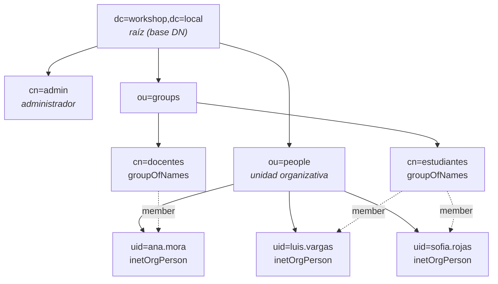

### 3.4 Anatomía de una entrada

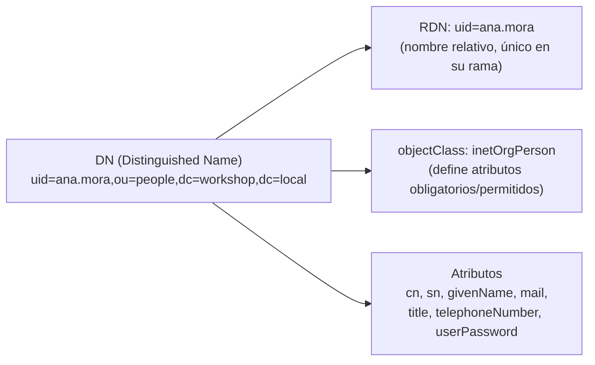

| Sigla | Significado | Ejemplo |
|---|---|---|
| `dc` | Domain Component | `dc=workshop,dc=local` |
| `ou` | Organizational Unit | `ou=people` |
| `cn` | Common Name | `cn=Ana Mora` |
| `uid` | User ID | `uid=ana.mora` |
| `sn` | Surname | `sn=Mora` |
| **DN** | Ruta completa y única de la entrada | `uid=ana.mora,ou=people,dc=workshop,dc=local` |
| **Base DN** | Desde dónde empieza una búsqueda | `ou=people,dc=workshop,dc=local` |
| **Bind DN** | Identidad con la que una app se autentica ante LDAP | `cn=admin,dc=workshop,dc=local` |

> El DN se lee **de derecha a izquierda**, igual que un dominio DNS o una ruta de archivos invertida.

### 3.5 Operaciones principales

| Operación | Qué hace | Herramienta CLI |
|---|---|---|
| **Bind** | Autenticarse | `-D <dn> -w <pass>` |
| **Search** | Buscar con filtro | `ldapsearch` |
| **Add** | Crear entrada | `ldapadd` |
| **Modify** | Cambiar atributos | `ldapmodify` |
| **Delete** | Borrar entrada | `ldapdelete` |
| **Compare** | Verificar un valor | `ldapcompare` |

### 3.6 Filtros LDAP (sintaxis prefija)

| Filtro | Significado |
|---|---|
| `(uid=ana.mora)` | uid igual a ana.mora |
| `(cn=*Mora*)` | cn contiene "Mora" |
| `(&(objectClass=inetOrgPerson)(title=Docente))` | Y lógico |
| `(\|(uid=ana.mora)(uid=luis.vargas))` | O lógico |
| `(!(title=Docente))` | Negación |
| `(memberOf=cn=docentes,ou=groups,dc=workshop,dc=local)` | Pertenencia a grupo (requiere overlay `memberof`) |

### 3.7 Cómo autentica una aplicación con LDAP (patrón "search + bind")

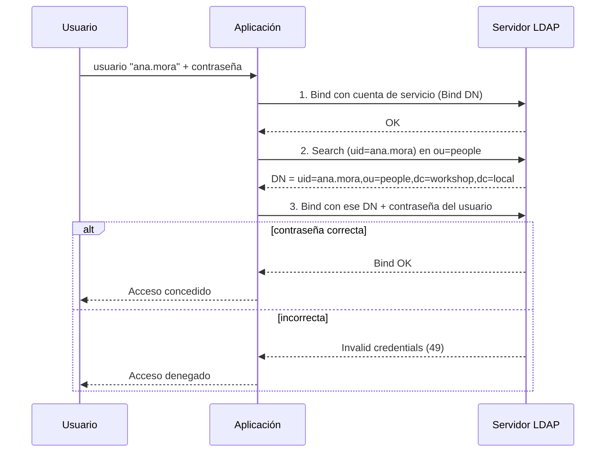

> La aplicación **nunca lee ni almacena** la contraseña del usuario: delega la verificación al servidor LDAP.

---

## 4. Arquitectura del laboratorio

### 4.1 ¿2 o 3 contenedores?

WordPress necesita base de datos. Por eso el esquema natural es de **3 contenedores**:

| # | Servicio | Imagen | Rol |
|---|---|---|---|
| 1 | `openldap` | `osixia/openldap:1.5.0` | Directorio de usuarios |
| 2 | `db` | `mariadb:11` | Base de datos de WordPress |
| 3 | `wordpress` | Imagen propia basada en `wordpress:php8.3-apache` | Sitio web + plugin LDAP |
| 4 *(opcional)* | `phpldapadmin` | `osixia/phpldapadmin:0.9.0` | Interfaz web para ver el árbol LDAP |


> **Sobre la imagen de OpenLDAP (nov-2026):** las imágenes `bitnami/openldap` dejaron de ser gratuitas en Docker Hub (agosto-septiembre 2025) y `bitnamilegacy/openldap` quedó congelada sin parches. `osixia/openldap:1.5.0` es antigua (OpenLDAP 2.4.57) pero es la más documentada y simple para docencia. **No usar en producción.** Alternativa mantenida: `vegardit/openldap` (variables de entorno distintas).

### 4.2 Diagrama de arquitectura

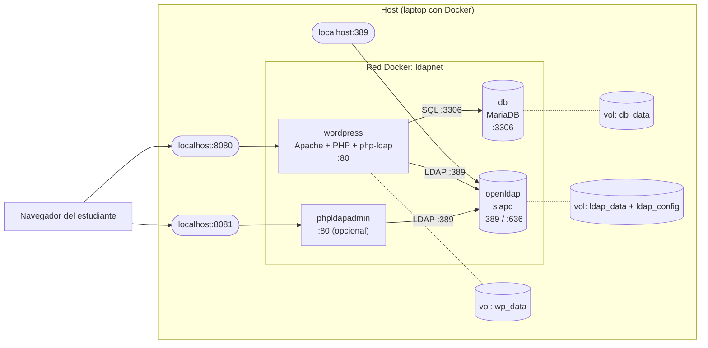

### 4.3 Estructura de archivos

```
workshop-ldap/
├── docker-compose.yml
├── .env
├── wordpress/
│   └── Dockerfile
└── ldif/
    └── 01-usuarios.ldif
```

---

## 5. Laboratorio paso a paso

### Paso 0 — Prerrequisitos

```bash
docker --version          # Docker 24+ recomendado
docker compose version    # Compose v2 (plugin, sin guion)
mkdir -p workshop-ldap/{wordpress,ldif} && cd workshop-ldap
```

### Paso 1 — Variables de entorno (`.env`)

```dotenv
LDAP_ORGANISATION=Workshop
LDAP_DOMAIN=workshop.local
LDAP_ADMIN_PASSWORD=admin123

DB_ROOT_PASSWORD=root123
DB_NAME=wordpress
DB_USER=wpuser
DB_PASSWORD=wp123
```

> `LDAP_DOMAIN=workshop.local` genera automáticamente el base DN `dc=workshop,dc=local` y el admin `cn=admin,dc=workshop,dc=local`.
> Contraseñas triviales **solo** porque es un laboratorio.

### Paso 2 — Imagen propia de WordPress con soporte LDAP (`wordpress/Dockerfile`)

La imagen oficial de WordPress **no incluye la extensión PHP `ldap`**. Sin ella, ningún plugin LDAP funciona. Este es el momento ideal para enseñar `Dockerfile`:

```dockerfile
FROM wordpress:php8.3-apache

# Instala la librería de desarrollo de LDAP y compila la extensión PHP
RUN apt-get update \
 && apt-get install -y --no-install-recommends libldap2-dev \
 && docker-php-ext-configure ldap --with-libdir=lib/$(uname -m)-linux-gnu/ \
 && docker-php-ext-install ldap \
 && rm -rf /var/lib/apt/lists/*
```

> `$(uname -m)` resuelve `x86_64` en PCs Intel/AMD y `aarch64` en ARM (Mac M1+, Raspberry Pi), así el mismo Dockerfile sirve para ambos.

### Paso 3 — Datos iniciales del directorio (`ldif/01-usuarios.ldif`)

```ldif
# --- Unidades organizativas ---
dn: ou=people,dc=workshop,dc=local
objectClass: organizationalUnit
ou: people

dn: ou=groups,dc=workshop,dc=local
objectClass: organizationalUnit
ou: groups

# --- Usuarios ---
dn: uid=ana.mora,ou=people,dc=workshop,dc=local
objectClass: inetOrgPerson
uid: ana.mora
cn: Ana Mora
givenName: Ana
sn: Mora
mail: ana.mora@workshop.local
title: Docente
telephoneNumber: +506 2222-0001
userPassword: Ana12345

dn: uid=luis.vargas,ou=people,dc=workshop,dc=local
objectClass: inetOrgPerson
uid: luis.vargas
cn: Luis Vargas
givenName: Luis
sn: Vargas
mail: luis.vargas@workshop.local
title: Estudiante
telephoneNumber: +506 2222-0002
userPassword: Luis12345

dn: uid=sofia.rojas,ou=people,dc=workshop,dc=local
objectClass: inetOrgPerson
uid: sofia.rojas
cn: Sofia Rojas
givenName: Sofia
sn: Rojas
mail: sofia.rojas@workshop.local
title: Estudiante
telephoneNumber: +506 2222-0003
userPassword: Sofia12345

# --- Grupos ---
dn: cn=docentes,ou=groups,dc=workshop,dc=local
objectClass: groupOfNames
cn: docentes
member: uid=ana.mora,ou=people,dc=workshop,dc=local

dn: cn=estudiantes,ou=groups,dc=workshop,dc=local
objectClass: groupOfNames
cn: estudiantes
member: uid=luis.vargas,ou=people,dc=workshop,dc=local
member: uid=sofia.rojas,ou=people,dc=workshop,dc=local
```

> Las líneas en blanco **separan entradas** en LDIF. Un espacio al final de una línea o una línea vacía faltante es el error más común del laboratorio.

### Paso 4 — Orquestación (`docker-compose.yml`)

```yaml
services:
  openldap:
    image: osixia/openldap:1.5.0
    container_name: openldap
    command: --copy-service          # necesario para cargar el LDIF montado
    environment:
      LDAP_ORGANISATION: ${LDAP_ORGANISATION}
      LDAP_DOMAIN: ${LDAP_DOMAIN}
      LDAP_ADMIN_PASSWORD: ${LDAP_ADMIN_PASSWORD}
      LDAP_TLS: "false"              # simplifica el laboratorio
    volumes:
      - ldap_data:/var/lib/ldap
      - ldap_config:/etc/ldap/slapd.d
      - ./ldif:/container/service/slapd/assets/config/bootstrap/ldif/custom
    ports:
      - "389:389"
    networks: [ldapnet]

  db:
    image: mariadb:11
    container_name: db
    environment:
      MARIADB_ROOT_PASSWORD: ${DB_ROOT_PASSWORD}
      MARIADB_DATABASE: ${DB_NAME}
      MARIADB_USER: ${DB_USER}
      MARIADB_PASSWORD: ${DB_PASSWORD}
    volumes:
      - db_data:/var/lib/mysql
    networks: [ldapnet]

  wordpress:
    build: ./wordpress
    container_name: wordpress
    depends_on: [db, openldap]
    environment:
      WORDPRESS_DB_HOST: db:3306
      WORDPRESS_DB_NAME: ${DB_NAME}
      WORDPRESS_DB_USER: ${DB_USER}
      WORDPRESS_DB_PASSWORD: ${DB_PASSWORD}
    volumes:
      - wp_data:/var/www/html
    ports:
      - "8080:80"
    networks: [ldapnet]

  # Opcional: interfaz web para explorar el árbol LDAP
  phpldapadmin:
    image: osixia/phpldapadmin:0.9.0
    container_name: phpldapadmin
    depends_on: [openldap]
    environment:
      PHPLDAPADMIN_LDAP_HOSTS: openldap
      PHPLDAPADMIN_HTTPS: "false"
    ports:
      - "8081:80"
    networks: [ldapnet]

volumes:
  ldap_data:
  ldap_config:
  db_data:
  wp_data:

networks:
  ldapnet:
```

> En equipos ARM (Mac Apple Silicon), si `osixia/*` falla al iniciar, agregar `platform: linux/amd64` a esos servicios.

### Paso 5 — Levantar todo

```bash
docker compose up -d --build
docker compose ps                     # los 3-4 servicios deben estar "running"
docker compose logs -f openldap       # Ctrl+C para salir
```

### Paso 6 — Verificar el directorio desde la terminal

```bash
# Buscar todos los usuarios
docker exec openldap ldapsearch -x -H ldap://localhost \
  -b "ou=people,dc=workshop,dc=local" \
  -D "cn=admin,dc=workshop,dc=local" -w admin123 \
  "(objectClass=inetOrgPerson)" uid cn mail title

# Probar que un usuario puede autenticarse (bind con su propio DN)
docker exec openldap ldapwhoami -x -H ldap://localhost \
  -D "uid=ana.mora,ou=people,dc=workshop,dc=local" -w Ana12345
# Esperado: dn:uid=ana.mora,ou=people,dc=workshop,dc=local
```

**Opcional:** abrir `http://localhost:8081` → Login DN `cn=admin,dc=workshop,dc=local`, contraseña `admin123`.

### Paso 7 — Verificar conectividad entre contenedores

```bash
# ¿WordPress tiene la extensión LDAP?
docker exec wordpress php -m | grep -i ldap        # debe imprimir "ldap"

# ¿WordPress resuelve y alcanza a OpenLDAP por nombre?
docker exec wordpress php -r '
$c = ldap_connect("ldap://openldap:389");
ldap_set_option($c, LDAP_OPT_PROTOCOL_VERSION, 3);
var_dump(ldap_bind($c, "cn=admin,dc=workshop,dc=local", "admin123"));'
# Esperado: bool(true)
```

> Si este paso funciona, cualquier fallo posterior es de **configuración del plugin**, no de Docker ni de red. Es la línea divisoria clave para depurar.

### Paso 8 — Instalar WordPress

1. Abrir `http://localhost:8080`.
2. Completar el asistente (idioma, título, usuario administrador local).
3. Entrar al panel `/wp-admin`.

### Paso 9 — Instalar y configurar el plugin LDAP

**Plugins → Añadir nuevo** → buscar el plugin LDAP elegido (por ejemplo, *LDAP Staff Directory* para publicar un directorio de personal desde LDAP) → Instalar → Activar.

Valores de conexión (los nombres de los campos varían según el plugin):

| Campo | Valor | Por qué |
|---|---|---|
| Servidor / Host | `openldap` | Nombre del servicio en la red Docker, **no** `localhost` |
| Puerto | `389` | LDAP sin TLS (laboratorio) |
| Usar TLS/SSL | No | Desactivado con `LDAP_TLS=false` |
| Versión del protocolo | 3 | Estándar actual |
| Bind DN | `cn=admin,dc=workshop,dc=local` | Cuenta con permiso de lectura |
| Contraseña del Bind | `admin123` | Del `.env` |
| Base DN | `ou=people,dc=workshop,dc=local` | Dónde buscar personas |
| Filtro | `(objectClass=inetOrgPerson)` | Solo personas |
| Atributo de usuario | `uid` | Identificador de login |
| Atributos a mostrar | `cn`, `mail`, `title`, `telephoneNumber` | Datos del directorio |

> **Error típico:** escribir `localhost` como host. Dentro del contenedor `wordpress`, `localhost` es el propio contenedor de WordPress, no OpenLDAP.

### Paso 10 — Prueba en vivo (el "momento wow")

1. Mostrar el directorio en WordPress con los 3 usuarios.
2. Agregar un usuario nuevo **en LDAP** (no en WordPress):

```bash
cat > /tmp/nuevo.ldif <<'EOF'
dn: uid=pedro.solis,ou=people,dc=workshop,dc=local
objectClass: inetOrgPerson
uid: pedro.solis
cn: Pedro Solis
sn: Solis
mail: pedro.solis@workshop.local
title: Estudiante
userPassword: Pedro12345
EOF

docker cp /tmp/nuevo.ldif openldap:/tmp/nuevo.ldif
docker exec openldap ldapadd -x -H ldap://localhost \
  -D "cn=admin,dc=workshop,dc=local" -w admin123 -f /tmp/nuevo.ldif
```

3. Recargar WordPress: Pedro aparece **sin tocar WordPress**. Esa es la tesis del taller: **una sola fuente de verdad para las identidades**.

### Paso 11 — Limpieza

```bash
docker compose down        # detiene y borra contenedores (conserva volúmenes)
docker compose down -v     # además borra volúmenes (reinicio total)
```

---

## 6. Flujo de conexión entre contenedores

### 6.1 Arranque

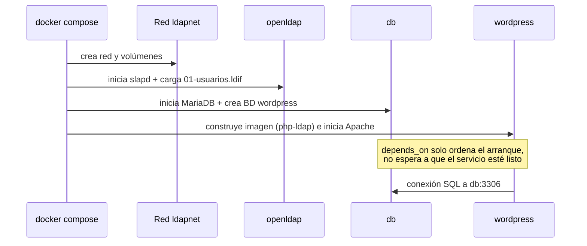

### 6.2 Petición de un visitante que ve el directorio

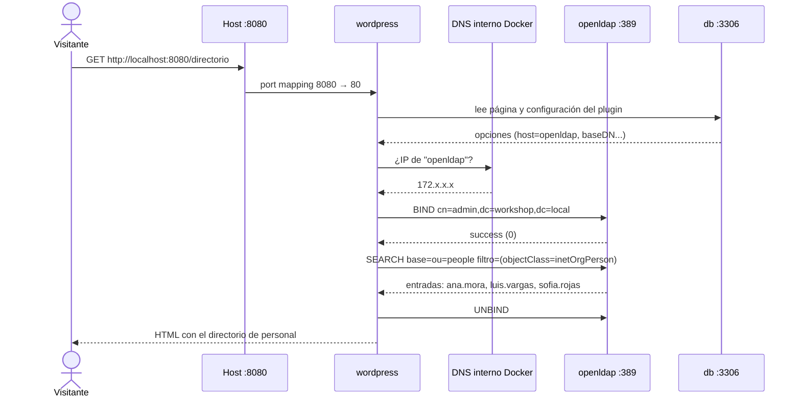

### 6.3 Mapa de puertos

| Origen | Destino | Puerto | Visible desde el host |
|---|---|---|---|
| Navegador | wordpress | 8080 → 80 | Sí |
| Navegador | phpldapadmin | 8081 → 80 | Sí |
| wordpress | db | 3306 | **No** (solo red interna) |
| wordpress | openldap | 389 | Interno (y publicado en 389 para pruebas) |
| phpldapadmin | openldap | 389 | Interno |

> Pregunta para el grupo: ¿por qué `db` **no** publica su puerto? Respuesta: principio de mínima exposición; solo WordPress necesita hablar con ella.

---

## 7. Otros casos de uso de LDAP

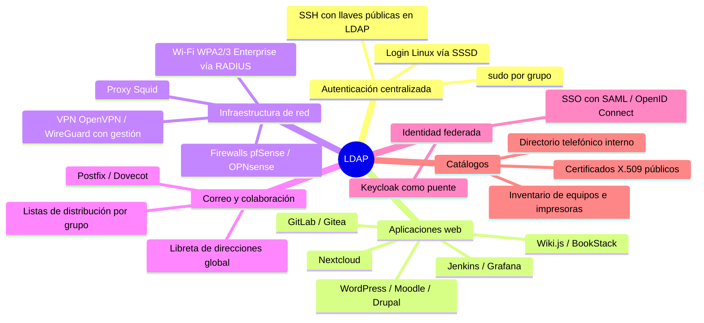

| Caso | Cómo participa LDAP | Ejemplo real |
|---|---|---|
| **Login único en servidores Linux** | SSSD consulta LDAP; el mismo usuario entra a 100 servidores | Laboratorios universitarios |
| **Wi-Fi empresarial** | FreeRADIUS valida contra LDAP; cada persona entra con sus credenciales | Campus, oficinas |
| **VPN** | El servidor VPN autentica contra LDAP y filtra por grupo | Teletrabajo |
| **Nextcloud / GitLab / Moodle** | Login y aprovisionamiento automático de cuentas | Plataformas educativas |
| **SSO moderno** | Keycloak usa LDAP como *user federation* y expone OIDC/SAML | Portales con "Iniciar sesión una vez" |
| **Correo** | Postfix/Dovecot resuelven buzones y alias desde LDAP | Servidores de correo propios |
| **Directorio telefónico** | Teléfonos IP y clientes de correo leen la agenda global | Centralitas Asterisk |
| **Alta/baja de personal** | Desactivar 1 cuenta en LDAP revoca acceso a todos los sistemas | Recursos Humanos / TI |

> **Mensaje clave:** el valor de LDAP no es técnico, es organizacional. Cuando alguien deja la organización, se desactiva **una** cuenta y pierde acceso a todo. Sin directorio central, quedan cuentas huérfanas en cada sistema (riesgo de seguridad real).

### 7.1 LDAP en el ecosistema de identidad moderno

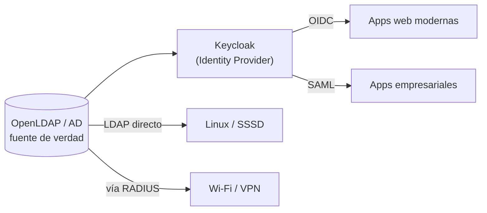

---

## 8. Solución de problemas

| Síntoma | Causa probable | Solución |
|---|---|---|
| `Can't contact LDAP server (-1)` | Host incorrecto (`localhost`) o contenedor caído | Usar `openldap` como host; `docker compose ps` |
| `Invalid credentials (49)` | Bind DN o contraseña erróneos | Revisar DN completo y `.env` |
| `No such object (32)` | Base DN incorrecto | `ldapsearch -b "dc=workshop,dc=local"` para ver el árbol |
| El plugin dice "LDAP extension not loaded" | Se usó la imagen oficial sin `build` | `docker compose up -d --build` y `php -m \| grep ldap` |
| El LDIF no se cargó | Falta `command: --copy-service`, error de sintaxis, o el volumen ya existía | `docker compose down -v` y volver a levantar; revisar logs |
| WordPress: "Error establishing a database connection" | MariaDB aún iniciando | Esperar 10-20 s y recargar |
| Puerto 389 u 8080 ocupado | Otro servicio en el host | Cambiar el mapeo, p. ej. `"1389:389"` |
| `exec format error` en Mac M1+ | Imagen solo amd64 | `platform: linux/amd64` en el servicio |

**Comandos de diagnóstico:**

```bash
docker compose ps
docker compose logs openldap --tail 50
docker exec -it wordpress bash
docker network inspect workshop-ldap_ldapnet
```

---

## 9. Notas para el instructor

- **No depender del Wi-Fi del aula.** Hacer `docker compose pull` y `docker compose build` antes del taller y llevar las imágenes exportadas (`docker save -o imagenes.tar ...`) en USB. Con 20 personas descargando ~1 GB a la vez, el laboratorio muere en el paso 5.
- **Validar el entorno de los estudiantes antes del día:** enviar un "Paso 0" con `docker run hello-world`. Windows sin WSL2 o sin virtualización habilitada en BIOS es el bloqueo número uno, y consume 30 minutos de taller si se descubre en vivo.
- **Repositorio con la solución terminada** (y una rama `inicio` con archivos incompletos) para que nadie quede rezagado.
- **Ensayar el plugin elegido** con exactamente estas versiones; la tabla del Paso 9 es genérica y los nombres de campos cambian entre plugins.
- **Seguridad explícita:** decir en voz alta que `LDAP_TLS=false`, contraseñas en texto plano y Bind con `cn=admin` son atajos de laboratorio. En producción: LDAPS (636), cuenta de servicio de **solo lectura**, contraseñas con hash (`slappasswd`) y secretos fuera del repositorio.

### Distribución de tiempo sugerida

| Bloque | Minutos |
|---|---|
| Docker: conceptos + demo `docker run nginx` | 35 |
| LDAP: conceptos, DIT, filtros | 35 |
| Pausa | 10 |
| Laboratorio pasos 1-7 | 45 |
| Laboratorio pasos 8-10 (WordPress + plugin + demo en vivo) | 35 |
| Casos de uso + preguntas | 20 |

---

## 10. Ejercicios de cierre

1. Agregar un usuario con `title: Coordinador` y un grupo `coordinacion`; mostrar solo a los docentes con un filtro.
2. Cambiar el teléfono de un usuario con `ldapmodify` y verificar que WordPress refleja el cambio.
3. Crear una cuenta de servicio `cn=wp-reader,dc=workshop,dc=local` y usarla en el plugin en lugar de `cn=admin`. ¿Por qué es más seguro?
4. Borrar y recrear el contenedor `openldap` **sin** borrar volúmenes. ¿Siguen los usuarios? ¿Por qué?
5. (Reto) Habilitar LDAPS: `LDAP_TLS=true`, publicar el puerto 636 y conectar el plugin usando `ldaps://openldap:636`.

---

### Referencias

- OpenLDAP: https://www.openldap.org/doc/
- Imagen osixia/openldap: https://github.com/osixia/docker-openldap
- Imagen oficial de WordPress: https://hub.docker.com/_/wordpress
- Documentación de Docker Compose: https://docs.docker.com/compose/
- RFC 4511 (protocolo LDAP): https://www.rfc-editor.org/rfc/rfc4511
- RFC 4515 (filtros LDAP): https://www.rfc-editor.org/rfc/rfc4515
